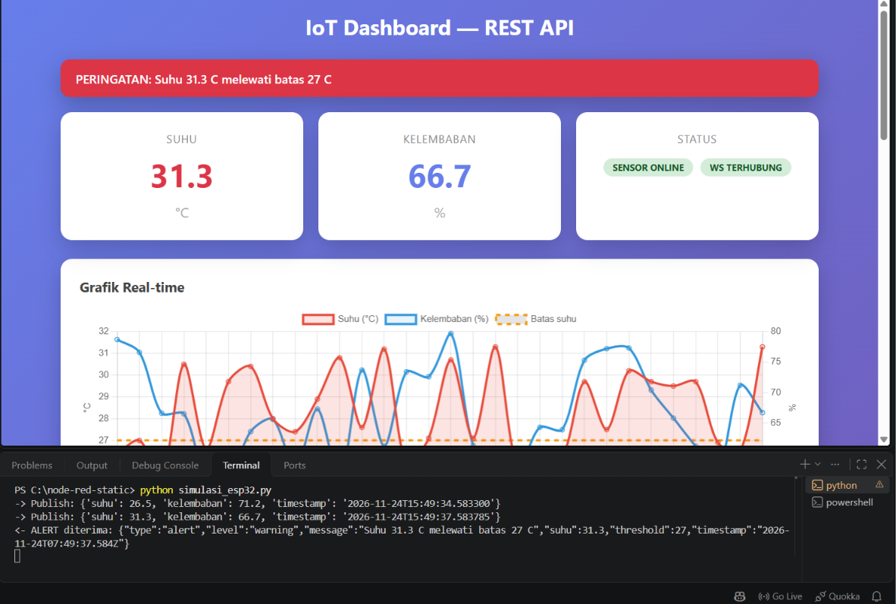
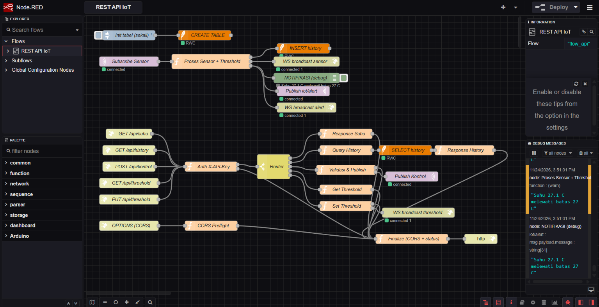
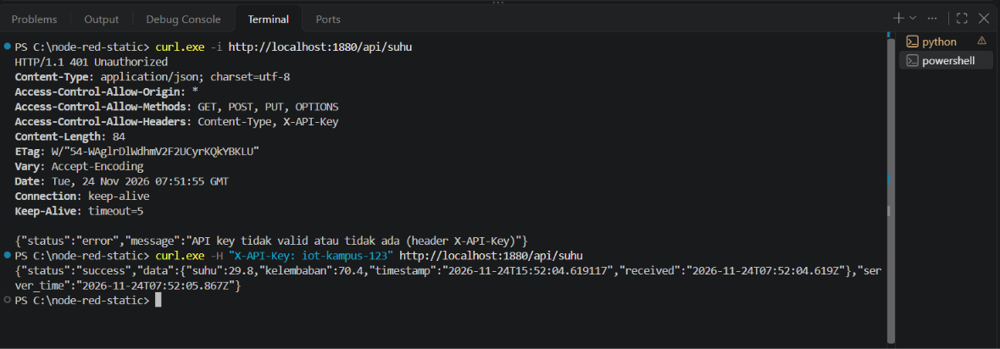
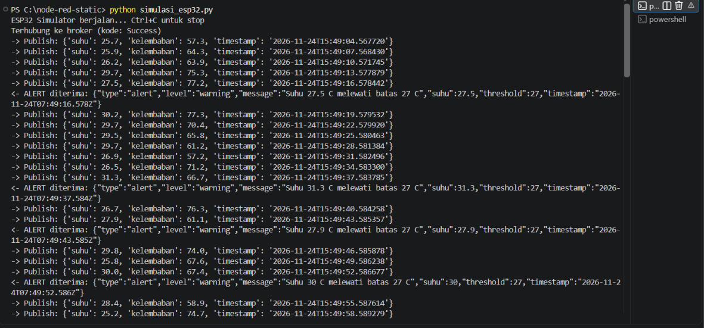
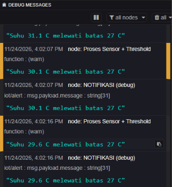
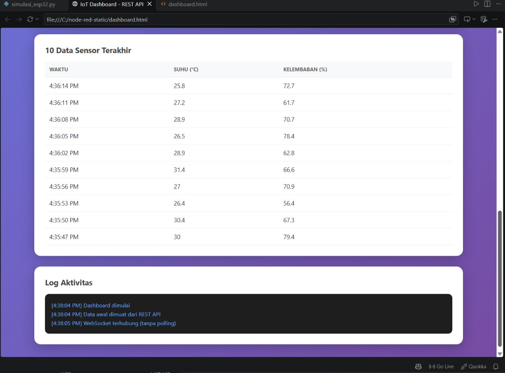
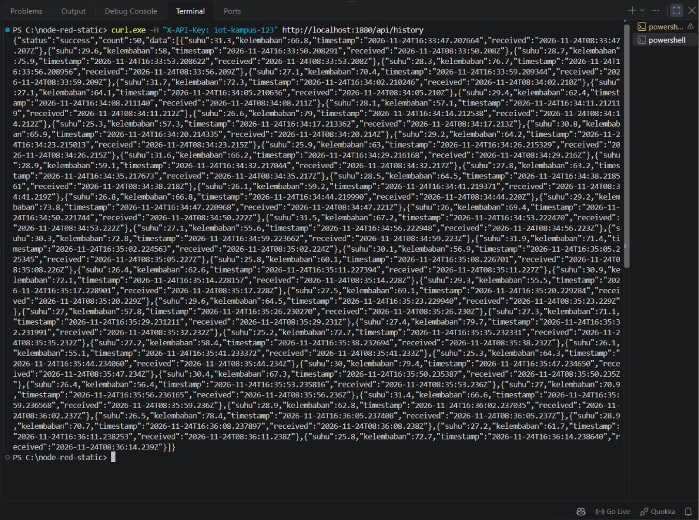

# Tugas Praktek 9 — REST API Node-RED untuk Sistem IoT

**Nama:** M. Ibnu  
**NPM:** 2410010254  
**Mata kuliah:** IoT

Sistem monitoring & kontrol IoT dengan alur:

**ESP32 (simulator Python) → MQTT (Mosquitto) → Node-RED (REST API + WebSocket + SQLite) → Dashboard web**

## Struktur repo

```
.
├── README.md
├── flows.json              # flow Node-RED (import lewat menu ☰ → Import)
├── simulasi_esp32.py       # simulator ESP32 (publisher MQTT)
├── static/
│   └── dashboard.html      # dashboard web (Chart.js + WebSocket)
└── screenshots/            # bukti hasil pengujian
```

## Fitur dasar (sesuai modul)

| Endpoint | Method | Fungsi |
|---|---|---|
| `/api/suhu` | GET | Data sensor terakhir |
| `/api/history` | GET | 50 data sensor terakhir (dari SQLite) |
| `/api/kontrol` | POST | Kirim perintah ke ESP32 via MQTT |

## Nilai tambah (5 tugas pengembangan)

| No | Tugas | Implementasi |
|---|---|---|
| 1 | Endpoint `/api/threshold` (PUT) + notifikasi | `PUT /api/threshold` dengan body `{"threshold": 30}` untuk mengubah batas suhu, `GET /api/threshold` untuk membaca. Notifikasi dikirim saat suhu **baru melewati** batas (tidak berulang selama suhu tetap di atas batas) lewat debug panel Node-RED, MQTT topic `iot/alert`, dan banner di dashboard. |
| 2 | Grafik real-time Chart.js | Grafik suhu, kelembaban, dan garis batas suhu di dashboard. |
| 3 | Autentikasi API key | Semua endpoint `/api/*` (kecuali preflight CORS) wajib header `X-API-Key`. Tanpa key atau key salah → `401`. |
| 4 | WebSocket di Node-RED | Path `/ws/sensor`. Dashboard menerima data sensor, alert, dan perubahan threshold secara push tanpa polling, dengan auto-reconnect. |
| 5 | History ke database | SQLite (`iot.db`, tabel `sensor_history`) menggantikan flow context. Data tetap ada setelah Node-RED di-restart. |

### Tentang API key
Nilai default API key adalah `iot-kampus-123`. Nilai ini disimpan sebagai environment variable `API_KEY` pada tab flow Node-RED, dan juga ditulis di `dashboard.html` (konstanta `API_KEY`). Jika ingin mengganti, ubah di **kedua** tempat tersebut.

## Cara menjalankan

Prasyarat: Node-RED, Mosquitto, Python 3, dan `pip install paho-mqtt`.

1. Install node SQLite di Node-RED: ☰ → *Manage palette* → *Install* → cari `node-red-node-sqlite`.
2. Jalankan Mosquitto: `mosquitto -v`
3. Jalankan Node-RED: `node-red`
4. Import `flows.json`: ☰ → *Import* → pilih file → *Import*, lalu klik **Deploy**.
5. Salin `static/dashboard.html` ke folder static Node-RED (folder yang diset sebagai `httpStatic` di `settings.js`, atau buka file langsung dari browser).
6. Jalankan simulator: `python simulasi_esp32.py`
7. Buka dashboard dan pastikan badge **SENSOR ONLINE** dan **WS TERHUBUNG** berwarna hijau.

Catatan: file database `iot.db` dibuat otomatis di folder tempat perintah `node-red` dijalankan, dan tabelnya dibuat oleh node *Init tabel*.

## Pengujian (curl)

Di Windows PowerShell gunakan `curl.exe`.

```bash
# tanpa API key -> 401
curl.exe -i http://localhost:1880/api/suhu

# dengan API key -> data sensor terakhir
curl.exe -H "X-API-Key: iot-kampus-123" http://localhost:1880/api/suhu

# history dari SQLite
curl.exe -H "X-API-Key: iot-kampus-123" http://localhost:1880/api/history

# kontrol lampu
curl -X POST http://localhost:1880/api/kontrol -H "X-API-Key: iot-kampus-123" -H "Content-Type: application/json" -d '{"device":"lamp","action":"on"}'

# ubah threshold
curl -X PUT http://localhost:1880/api/threshold -H "X-API-Key: iot-kampus-123" -H "Content-Type: application/json" -d '{"threshold":28}'
```

## Verifikasi end-to-end

| Komponen | Cara verifikasi | Hasil |
|---|---|---|
| Simulator → MQTT | Terminal simulator menampilkan `-> Publish: {...}` | Berhasil |
| MQTT → Node-RED | Node *Subscribe Sensor* berstatus connected, data diproses | Berhasil |
| Node-RED → REST | `curl` ke `/api/suhu` mengembalikan JSON | Berhasil |
| REST → Web | Dashboard menampilkan angka dan grafik berubah | Berhasil |
| Web → REST → MQTT | Tombol lampu menghasilkan `<- KONTROL diterima` di simulator | Berhasil |
| Threshold → Alert | Suhu melewati batas memicu notifikasi dan `<- ALERT diterima` | Berhasil |
| API key | Tanpa key `401`, dengan key data JSON | Berhasil |
| SQLite | Setelah restart Node-RED, history tetap terisi | Berhasil |

## Hasil Pengujian (Screenshot)

**1. Dashboard** — data sensor, grafik Chart.js real-time, status WebSocket, dan banner peringatan saat suhu melewati batas.



**2. Flow Node-RED** — backend REST API, WebSocket, notifikasi threshold, dan penyimpanan SQLite.



**3. Autentikasi API key** — request tanpa header `X-API-Key` ditolak (401), dengan key yang benar mengembalikan data.



**4. Simulator ESP32** — menerima notifikasi `iot/alert` dan perintah `iot/kontrol` lewat MQTT.



**5. Notifikasi di Node-RED** — pesan saat suhu baru melewati threshold.



**6. History tersimpan di SQLite** — setelah Node-RED di-restart (dan simulator dimatikan), tabel di dashboard dan endpoint `/api/history` tetap berisi data.





## Catatan keamanan
- Koneksi WebSocket belum memakai API key (hanya mengirim data sensor). Untuk produksi, tambahkan token pada query string dan validasi saat koneksi.
- API key di `dashboard.html` terlihat oleh siapa pun yang membuka halaman. Ini cukup untuk tugas, bukan untuk produksi.
